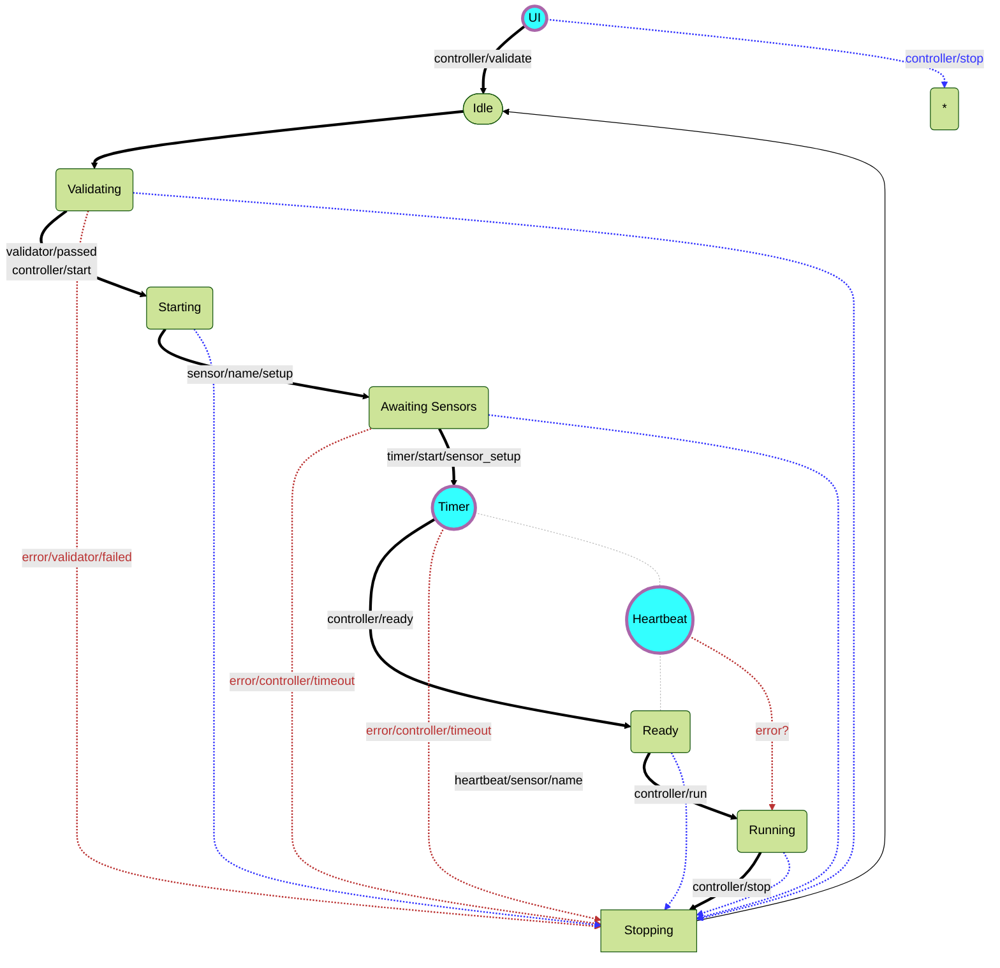

# Controller
The controller is responsible for receiving, validating, orchestrating, monitoring and terminating experiments.

## Standard flow
A normal flow of an experiment is as follows:
- The experiment configuration is received from the UI through an mqtt message.
- The controller validates the configuration through the experiment schema.
- The controller sends the configuration to the sensors/actuators, and makes sure they are received by monitoring their heartbeats.
- The experiment is then started, and the controller sends setpoints at regular intervals.
- The controller monitors the experiment through the heartbeats of the sensors/actuators, and the data they send.
- When the experiment is finished, the controller reverts to an idle state.

## Graphical representation
The following diagram sumarises the controller's flow:

## MQTT driven state machine

The controller is implemented as a state machine, changing state by updating its callback, and reacting to mqtt messages.
The controller can be in one of the following states:

- **Idle**: The controller is waiting for an experiment configuration. 
  In this state, the controller expects a `controller/validate` message containing a JSON object with a "file" key, which contains the path to the experiment file.
  The id of the experiment is temporary, and will remain so until the controller reaches the "ready" state.
  If the experiment is valid, the controller state is updated to "validating".
- **Validating**: The controller is validating the experiment configuration.
  It checks the experiment file against the experiment schema.
  If the validation fails, the controller resets to the "idle" state and publishes an error.
  If the validation passes, the controller state is updated to "starting".
  It then triggers the configuration process with a `controller/start` message.
- **Starting**: In this state, the controller computes intermediate setpoints and sends configuration to the sensors.
  The configuration is sent to the sensors through `sensor/sensor_name/setup` messages.
  The controller state is updated to "awaiting_sensors".
- **Awaiting Sensors**: The controller waits for all sensors to be ready.
  If at least one sensor configuration fails, the controller times out, resets to the "idle" state and publishes an error.
  If all sensors have the correct configuration, the controller state is updated to "ready".
  It then triggers the last preparation stage with a `controller/ready` message.
- **Ready**: The controller is ready to start the experiment.
  It assigns a serial ID to the experiment and updates the state to "running".
  It then triggers the experiment start with a `controller/run` message.
- **Running**: The controller is running the experiment.
  It sends setpoints to the sensors at regular time intervals, and monitors their status.
  If the experiment is finished, the controller updates the state to "stopping",
  and triggers the experiment stop with a `controller/stop` message.
- **Stopping**: The controller is stopping the experiment.
  It ensures a safe stop of the experiment and then resets the state to "idle".

The controller can also be stopped at any point by sending a `controller/stop` message, except when the controller is in the "idle" state.

Most of the state machine logic is implemented in the `on_controller_message.py` file.
Several callback functions are implemented for the controller, and switched as it transitions states.

## Helper clients

There are a few helper clients to the controller:
- The **ui** client, which is responsible for receiving the experiment configuration or stop signals from the UI.
  It listens to the `ui/start` and `ui/stop` topics.
  - When it receives a `ui/start` message, it saves the experiment configuration to a temporary file and sends a `controller/validate` message, to trigger the controller.
  - When it receives a `ui/stop` message, it sends a `controller/stop` message to trigger the controller.

- The **timer** client, which offloads waiting tasks from the controller, so that it can still respond to callbacks.
  For example, it is responsible to send a timeout signal if not all sensors get configured.

- The **heartbeat** client, which is responsible for receiving heartbeat messages from the sensors.
  It listens to the `heartbeat/sensor/#` topic, and updates the sensor's status in the controller state.

- The **measurement** client, which is responsible for receiving measurement data.
  <!-- The topics it listens to and its exact responsibilities are not yet clear. -->

- The **watchdog** client, 
  <!-- Not defined yet-->

