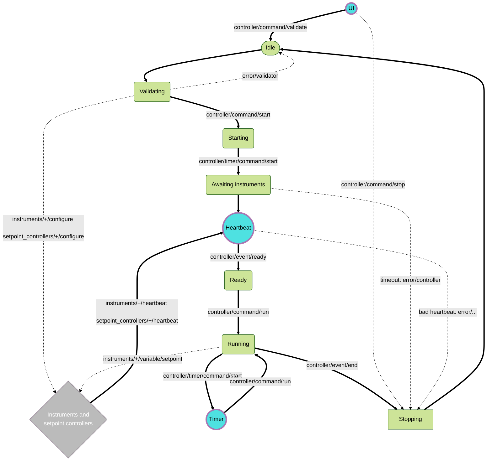

# Controller
The controller is responsible for receiving, validating, orchestrating, monitoring and terminating experiments.

- [Controller](#controller)
  - [Standard flow](#standard-flow)
  - [Graphical representation](#graphical-representation)
  - [MQTT driven state machine](#mqtt-driven-state-machine)
    - [Stopping and errors](#stopping-and-errors)
  - [Helper clients](#helper-clients)
  - [Experiment message](#experiment-message)
  - [Experiment data](#experiment-data)
  - [Configuration](#configuration)
  - [Running tests](#running-tests)

## Standard flow
A normal flow of an experiment is as follows:
- The experiment is received from the UI through a `ui/start` MQTT message.
- The controller validates the experiment against the [message schema](../schemas/mqtt_schema.yaml) and against `comodo.yaml`,
  and assigns it an experiment id.
- The controller sends the live configuration to the instruments and setpoint controllers,
  and waits until their heartbeats confirm they are configured and running.
- The experiment is then run: the controller sends setpoints to the instruments at regular intervals (the experiment's resolution).
- The controller monitors the experiment through the heartbeats of the instruments and setpoint controllers.
- When the experiment is finished, the controller saves the experiment data and reverts to an idle state.

## Graphical representation
The following diagram summarises the controller's flow:



## MQTT driven state machine

The controller is implemented as a state machine, changing state by updating its callback, and reacting to MQTT messages.
The controller can be in one of the following states:

- **Idle**: The controller is waiting for an experiment.
  In this state, the controller expects a `controller/command/validate` message, containing the experiment's `temp_id`,
  and a `file` key with the path to the experiment file (saved by the [UI client](#helper-clients)).
- **Validating**: The controller validates the experiment (see [experiment message](#experiment-message)).
  If the validation fails, the controller publishes an error on `error/validator` and resets to the "idle" state.
  If the validation passes:
  - It computes the intermediate setpoints at the experiment's resolution.
  - It assigns a serial id to the experiment (`DYY-XXX`), and publishes it on `controller/validator/passed`, together with the `temp_id`.
  - It sends the live configuration to the instruments (`instruments/<name>/configure`) and setpoint controllers (`setpoint_controllers/<id>/configure`).
  - It publishes a `controller/command/start` message.
- **Starting**: The controller prepares to track the state of every instrument and setpoint controller in `comodo.yaml`.
  It then updates the state to "awaiting_instruments", and starts the instrument setup timer with a `controller/timer/command/start` message.
- **Awaiting instruments**: The controller waits for all instruments to report a "running" status, and for all setpoint controllers to report their configuration, through their heartbeats.
  When they are all ready, the heartbeat client publishes a `controller/event/ready` message.
  If they are not ready within `global.instrument_setup.wait` seconds (from `comodo.yaml`), the timer publishes an error and stops the experiment.
- **Ready**: The controller is ready to start the experiment.
  It updates the state to "running", and triggers the experiment with a `controller/command/run` message.
- **Running**: For each `controller/command/run` message, the controller publishes the next setpoint to each instrument (`instruments/<name>/<variable>/setpoint`),
  and starts a timer for the setpoint's duration. When the timer is done, it publishes the next `controller/command/run`.
  When there are no more setpoints, the controller publishes a `controller/event/end` message.
- **Stopping**: The controller saves the [experiment data](#experiment-data), and then resets to the "idle" state.

Most of the state machine logic is implemented in [`on_controller_message.py`](src/on_controller_message.py).
Several callback functions are implemented for the controller, and switched as it transitions states.

### Stopping and errors
- The experiment can be stopped at any point, except when the controller is idle, with a `controller/command/stop` message containing the experiment id.
- If an instrument or setpoint controller reports a configuration that does not match the live configuration, the controller publishes an error and stops the experiment.
- If an instrument stays in a bad state, or takes too long to reach its setpoint, the controller moves to the "error" state
  (see `global.experiment_monitoring` in `comodo.yaml`). While in the "error" state, it publishes a `controller/command/stop` message with every heartbeat.
- If a state callback raises an unexpected exception, the controller moves to the "error" state, and stops the experiment if it had started.

All errors are published on `error/<source>` topics, and shown in the UI's log.

## Helper clients

There are a few helper clients to the controller, each listening to its own topics:
- The **ui** client listens to `ui/#`.
  - When it receives a `ui/start` message, and the controller is idle, it saves the experiment to a temporary file
    and sends a `controller/command/validate` message, to trigger the controller.
  - When it receives a `ui/stop` message with the current experiment id, it sends a `controller/command/stop` message.
- The **timer** client listens to `controller/timer/#`. It offloads waiting from the controller, so that it can still respond to messages.
  It is used to wait for the instruments to be ready, and for each setpoint's duration.
- The **heartbeat** client listens to `instruments/+/heartbeat` and `setpoint_controllers/+/heartbeat`.
  It updates the state of each instrument and setpoint controller, checks their configuration, and signals when they are all ready.
- The **watchdog** and **watchdog timer** clients check that the controller is alive, by listening to `controller/heartbeat` and `error/exception`.
  If no heartbeat is received within `global.watchdog.timeout` seconds, or if an exception is published, the controller exits,
  and Docker restarts it.

The controller itself publishes its state on `controller/heartbeat` every `global.heartbeat.interval` seconds.

## Experiment message
An experiment is started with a `ui/start` message, normally sent by the UI. For example:
```json
{
  "temp_id": "123",
  "config": {
    "resolution": 2,
    "instruments": {
      "furnace": {"temperature": {"tolerance": 5}},
      "pressure": {"pressure": {"tolerance": 0.2}}
    },
    "spcs": {
      "pressure-pressure--mass_flow-mass_flow": {
        "pid": {"k_p": 10.0, "k_i": 1.0, "k_d": 0.1, "k_aw": 0.05, "k_df": 0.02, "max_rate": null}
      }
    }
  },
  "experiment_definition": [
    {"time": 0, "furnace/temperature": 25, "pressure/pressure": 1},
    {"time": 10, "furnace/temperature": 50, "pressure/pressure": 1.5, "pressure/pressure_profile": "step"}
  ]
}
```
- `temp_id`: A temporary id, used until the controller assigns the experiment id.
- `config`: The live configuration of the experiment.
  - `resolution`: Time in seconds between setpoints.
  - `instruments`: Live configuration sent to each instrument. It must include a `tolerance` for every variable that drives an actuator.
  - `spcs`: The PID parameters for each setpoint controller in `comodo.yaml`. All of them must be included.
    The id of a setpoint controller is `<sensor instrument>-<sensor variable>--<actuator instrument>-<actuator variable>`.
- `experiment_definition`: The list of setpoints. Each row has:
  - `time`: Time in seconds from the start of the experiment.
  - `<instrument>/<variable>`: The setpoint for each variable that drives an actuator, within the variable's `min` and `max`.
  - `<instrument>/<variable>_profile`: [optional] How to get to this setpoint from the previous one: `linear` (default), `exponential`, `logarithmic` or `step`.

The time between rows must be at least the `resolution`.

## Experiment data
Experiments are saved in the `data/` folder (mounted from `controller/data/`):
- `DYY-XXX.json`: The experiment message, where `YY` is the year and `XXX` a serial number.
- `DYY-XXX/<bucket>.csv`: The InfluxDB data recorded during the experiment, saved when the experiment stops.

## Configuration
The controller reads `comodo.yaml` from `/app/comodo.yaml`, and the following environment variables:
- `MQTT_HOST`, `MQTT_USER` and `MQTT_PASS` (or `MQTT_PASS_FILE`): The MQTT broker and its credentials.
- `MQTT_CONNECTION_TIMEOUT`: [optional] Time in seconds to wait for the broker. Defaults to 10.
- `INFLUX_HOST`, `INFLUX_ORG`, `INFLUX_BUCKET` and `INFLUX_TOKEN` (or `INFLUX_TOKEN_FILE`): The InfluxDB instance, used to save the experiment data.

These are set by the main [`compose.yaml`](../compose.yaml) from the `.env` file.

## Running tests

The controller comes with a full suite of unit and integration tests. It can be
useful to run these for development purposes or for finding the cause of failures.

We recommend running the tests using the scaffolding provided by Docker Compose. From the `controller/` directory:

```shell
docker compose up --build
```

To check the coverage report after the tests have run:

```shell
xdg-open $(docker volume inspect controller-tests_memory -f '{{ .Mountpoint }}')/htmlcov/class_index.html
```
