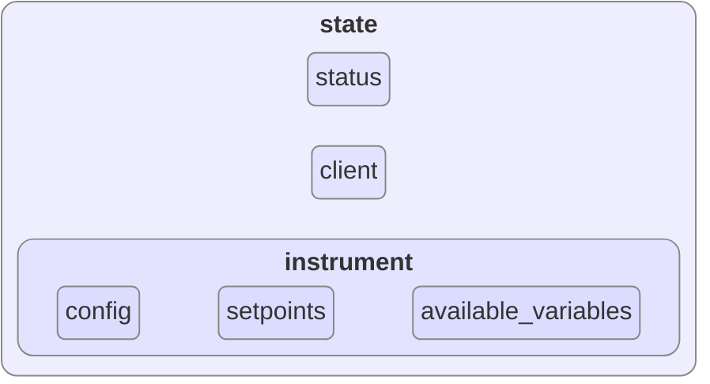
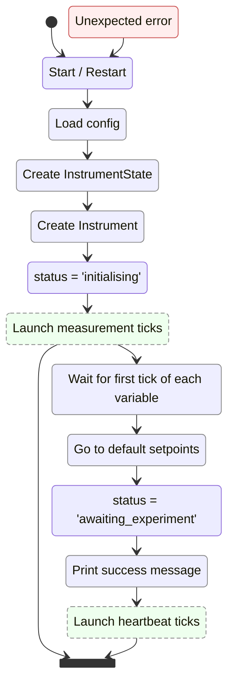
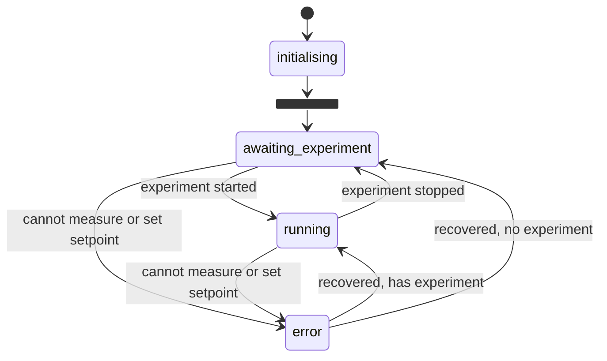

# Firmware

The firmware provides a standard interface between the comodo stack and individual instruments.

An instrument is understood as a device with a unique address, which may monitor and/or control one or more variables.

- [Firmware](#firmware)
  - [Configuration](#configuration)
    - [Generating the compose.firmware.yaml](#generating-the-composefirmwareyaml)
  - [Structure and life cycle](#structure-and-life-cycle)
    - [MQTT Topics](#mqtt-topics)
  - [Instrument modules](#instrument-modules)

## Configuration
The firmware expects to find its configuration through environment variables. These are usually set in the firmware's [compose file](#generating-the-composefirmwareyaml).

The expected environment variables are:
- `MQTT_USER`: The username for the MQTT broker.
- `MQTT_PASS`: The password for the MQTT broker.
- `MQTT_HOST`: The hostname of the MQTT broker.
- `INSTRUMENT_NAME`: The instrument id.
- `FIRMWARE`: The name of the [module](#instrument-modules) to be used (should match the name of the module in the `src/instruments` directory). If unset, or if "generic_instrument" is specified, the firmware will use the generic instrument class to simulate the instrument.
- `ADDRESS`: The address at which the instrument is contacted (e.g. a serial port, an IP address, etc.).
- `SIMULATE`: `true` if the instrument should be simulated, `false` otherwise. Defaults to `true`.
- `ACTIVE_VARIABLES`: A list of the variables that the instrument should monitor and/or control.
- `DEFAULT_SETPOINTS`: A dictionary of the default setpoints for each variable in the form `{variable: setpoint}`.
- `EXTERNAL_ACTUATORS`: A dictionary of the variables driven by another instrument's actuator (through a setpoint controller), in the form `{variable: "instrument/variable"}`.
  In simulation mode, the instrument listens to the external actuator's measurements to simulate the variable.
- `SAFE_STOP_SETPOINTS`: A dictionary of the safe stop setpoints for each variable in the form `{variable: setpoint}`. Currently not used by the firmware.
- `MEASUREMENT_INTERVALS`: A dictionary of the measurement intervals, in seconds, for each variable in the form `{variable: interval}`.
  A measurement tick is started for each variable in this dictionary.
- `HEARTBEAT_INTERVAL`: The interval, in seconds, at which the firmware publishes its heartbeat.


### Generating the compose.firmware.yaml

In a standard deployment, these are extracted from the `comodo.yaml` file and templated into the `compose.firmware.yaml` file using the `firmware/templates/compose.firmware.yaml.j2` jinja template. This can be accomplished by running:
```
docker compose -f "./firmware/compose.gen.yaml" run --rm compose-gen
```
from the comodo repository root (where the `comodo.yaml` file is located). `./utils/contexts.sh` also runs this step.

The `compose.firmware.yaml` file then provides the stack of instrument firmware containers, each with its own configuration,
as well as a container for each setpoint controller.

## Structure and life cycle
The firmware instantiates an `InstrumentState` object, which serves as the state machine for the instrument.
It owns a `status` string, an mqtt `client`, and an `Instrument` object. It is also responsible for redirecting the mqtt `callbacks` to the appropriate methods, and for publishing the instrument's `heartbeat`.

The `Instrument` object is the interface to the instrument itself.
It defines the `available_variables`, it stores the current `setpoints`, and owns the methods to measure and set setpoints.
The configuration is loaded from the environment variables, and stored in the Instrument object as `config`.

The structure of the firmware is then as follows:



The initialisation of the firmware is done by first loading the configuration, which is passed to the `InstrumentState` object, which in turn uses it to create the `Instrument` object. The `status` is set to `initialising`.
Then measurement ticks are launched asynchronously, one per variable in `MEASUREMENT_INTERVALS`.
Each tick publishes a measurement on `instruments/<instrument_name>/<variable>/measurement`.
Once the first tick of each variable is received, the instrument goes to the default setpoints, and the status is set to `awaiting_experiment`.
If any variable fails to produce a first measurement within 10 seconds, the initialisation fails.
Only then, a success message is printed, and the instrument's
heartbeat ticks are launched asynchronously.

While in the `awaiting_experiment` state, the instrument will continue to take measurements, and wait for an experiment to start.
In this state it also accepts the experiment's live configuration (`instruments/<instrument_name>/configure`), and setpoints.
When an experiment is started (`controller/command/start`), the instrument stores the experiment id, and the status is set to `running`.
The instrument will continue to take measurements and set setpoints.
When an experiment ends or is stopped (`controller/event/end` or `controller/command/stop`), the instrument goes back to its default setpoints,
clears the experiment id, and the status is set back to `awaiting_experiment`.

At any point, if the instrument cannot take a measurement (the measurement is `None`) or set a setpoint (`go_to_setpoint` raises an exception), the status is set to `error`. The instrument will nonetheless continue to try to take measurements and set setpoints, and if it succeeds, the status will be set back to `awaiting_experiment` or `running`, depending on whether an experiment is running or not.

The measurement and heartbeat ticks will continue to run indefinitely, unless an unexpected error occurs.
In such case, the firmware publishes the error on `error/instrument` and exits. Docker compose then restarts the firmware container, and the initialisation process is repeated.

The initialisation process of the firmware can be summarised as follows:


The status of an instrument can only be one of the following:
- `initialising`: The instrument is being initialised, and is not yet ready to take measurements or set setpoints.
- `awaiting_experiment`: The instrument is taking measurements and ready to set setpoints, but is waiting for an experiment to be started.
- `running`: The instrument is taking measurements and setting setpoints as expected.
- `error`: The instrument is unable to take measurements and/or set setpoints.

So its status transitions are as follows:


### MQTT Topics
The firmware subscribes to the following MQTT topics:
- `instruments/<instrument_name>/configure`: To receive live configuration while in `awaiting_experiment` status.
- `controller/command/start`: To fetch the experiment id and start an experiment (move to `running` status).
- `instruments/<instrument_name>/+/setpoint`: The desired setpoint for the variable identified by the wildcard.
  Setpoints are sent by the controller, or by a setpoint controller for actuators driven by another variable.
- `controller/event/end` and `controller/command/stop`: To end/stop the current experiment (move to `awaiting_experiment` status).
- `instruments/<instrument>/<variable>/measurement`: Only in simulation mode, for each of the `EXTERNAL_ACTUATORS`.

And publishes to:
- `instruments/<instrument_name>/<variable>/measurement`: Each measurement, as `{"value": <measurement>}`.
- `instruments/<instrument_name>/heartbeat`: Every `HEARTBEAT_INTERVAL` seconds, with:
  - `state`: The instrument's `status`, and its latest `measurements`.
  - `setpoints`: The current setpoints.
  - `config`: The instrument's configuration (without MQTT credentials), including the live configuration and experiment id under `experiment`.
    The controller compares this with the live configuration it sent, and stops the experiment if they don't match.
- `error/instrument`: If the firmware crashes.


## Instrument modules
The firmware modules are located in the `src/instruments` directory, grouped by manufacturer: `src/instruments/<manufacturer>/<model>.py`.
They are selected with `FIRMWARE=<manufacturer>.<model>` (e.g. `pfeiffer.mpt200`), which is set from the instrument's `firmware` in `comodo.yaml`.

Each module must define a class called `Instrument`, which is a subclass of the `BaseInstrument` class.
It must define the `available_variables` of the instrument, as a dictionary of `{variable: {"sensor": ..., "actuator": ...}}`,
where the values are whatever the module needs to read or write each variable (e.g. a register address), and `actuator` is `None` if the variable cannot be set.
It must also define the following methods:
- `initialise(self)`: Must perform all required initialisation for the instrument, including establishing a connection to the instrument and setting up any required parameters. This method must also be safe to call whether the instrument is being simulated or not.
- `simulate(self, variable)`: This method will only be called when the instrument is being simulated, and should return a simulated value for the given `variable`. It can immediately refer to the `self.default_sim(variable)`, but may be use to provide more realistic simulated behaviour of the instrument, which converges towards the variable's setpoint over time.
- `get_measurement(self, variable)`: This method will only be called when the instrument is not being simulated, and should return a measurement for the given `variable`. It must return `None` if the measurement cannot be taken, which sets the status to `error`.
  Raising an exception instead will crash the firmware.
- `go_to_setpoint(self, variable, setpoint)`: This method will only be called when the instrument is not being simulated, and only for variables with an `actuator`. It should direct the instrument to go to the given `setpoint` for the given `variable` if an actuator is available. It must raise an exception if there is an actuator available but the setpoint cannot be set.

It is expected that the modules follow this structure:

```
"""
<Name of the instrument for which this firmware is intended>
<link to the instrument's documentation>
"""

# System imports
from typing import ClassVar

# Instrument specific imports
<imports required for the instrument>

# Local imports
from src.instrument import BaseInstrument


# ======================================================================================
# Instrument Class
# --------------------------------------------------------------------------------------
class Instrument(BaseInstrument):
    available_variables: ClassVar[dict[str, dict]] = {
        <variable dicts>
    }

    def initialise(self):
        <implementation>

    def simulate(self, variable):
        <implementation>

    def get_measurement(self, variable):
        <implementation>

    def go_to_setpoint(self, variable, setpoint):
        <implementation>


# ======================================================================================

# ======================================================================================
# Configuration and helper functions
# --------------------------------------------------------------------------------------
<configuration and helper functions for the instrument>
```
