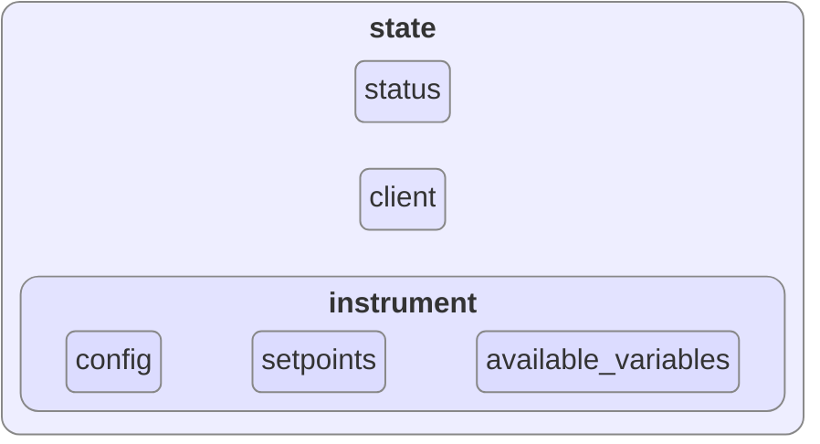
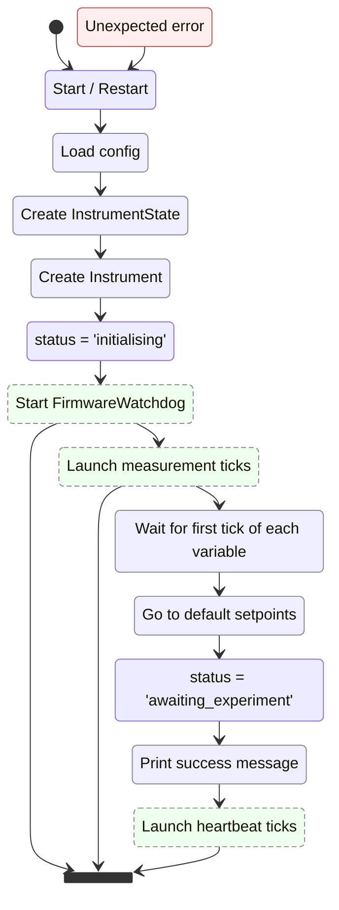
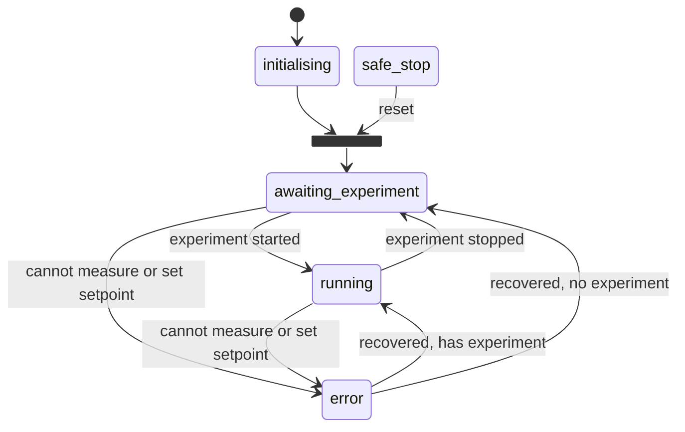

# Firmware

The firmware provides a standard interface between the comodo stack and individual instruments.

An instrument is understood as a device with a unique address, which may monitor and/or control one or more variables.

- [Firmware](#firmware)
  - [Configuration](#configuration)
    - [Experiment's live configuration](#experiments-live-configuration)
      - [Tolerance](#tolerance)
      - [Calibration](#calibration)
    - [Generating the compose/firmware.yaml](#generating-the-composefirmwareyaml)
  - [Structure and life cycle](#structure-and-life-cycle)
    - [Safe stop](#safe-stop)
    - [MQTT Topics](#mqtt-topics)
  - [Instrument modules](#instrument-modules)

## Configuration
The firmware expects to find its configuration through environment variables. These are usually set in the firmware's [compose file](#generating-the-composefirmwareyaml).

The expected environment variables are:
- `MQTT_USER`: The username for the MQTT broker.
- `MQTT_PASS`: The password for the MQTT broker.
- `MQTT_HOST`: The hostname of the MQTT broker.
- `INSTRUMENT_NAME`: The instrument id.
- `FIRMWARE`: The name of the [module](#instrument-modules) to be used (should match the name of the module in the `src/instruments` directory). If unset, or if "generic_instrument" is specified, the firmware will use the generic instrument class to simulate the instrument.
- `ADDRESS`: The address at which the instrument is contacted (e.g. a serial port, an IP address, etc.).
- `DEVICE_ID`: [optional] The id of the device at its `ADDRESS` (e.g. its Modbus address), for modules that need one. Empty if not given, in which case the module should use its own default.
- `SIMULATE`: `true` if the instrument should be simulated, `false` otherwise. Defaults to `true`.
- `ACTIVE_VARIABLES`: A list of the variables that the instrument should monitor and/or control.
- `DEFAULT_SETPOINTS`: A dictionary of the default setpoints for each variable in the form `{variable: setpoint}`.
- `EXTERNAL_ACTUATORS`: A dictionary of the variables driven by another instrument's actuator (through a setpoint controller), in the form `{variable: "instrument/variable"}`.
  In simulation mode, the instrument listens to the external actuator's measurements to simulate the variable.
- `SAFE_STOP_SETPOINTS`: A dictionary of the safe stop setpoints for each variable in the form `{variable: setpoint}`. Used when the instrument [safe stops](#safe-stop).
- `MEASUREMENT_INTERVALS`: A dictionary of the measurement intervals, in seconds, for each variable in the form `{variable: interval}`.
  A measurement tick is started for each variable in this dictionary.
- `VARIABLE_RANGES`: A dictionary of the range of each variable, from its `min` and `max` in `comodo.yaml`, in the form `{variable: {"min": min, "max": max}}`.
- `SIMULATION_INPUTS`: A dictionary of the inputs the instrument's simulation may follow (its `simulation_inputs` in `comodo.yaml`),
  using expected names as keys, and `instrument/variable` sources as values, with their range,
  in the form `{name: {"source": "instrument/variable", "min": min, "max": max}}`.
  In simulation mode, the instrument listens to their measurements, and saves them in `previous_measurements` (as `"instrument/variable"`).
  The instrument modules may use them, in the `simulate` method, getting each by name with `simulation_input(name)`.
- `HEARTBEAT_INTERVAL`: The interval, in seconds, at which the firmware publishes its heartbeat.
- `MAX_MISSED_HEARTBEATS`: The number of controller heartbeats that can be missed before the instrument [safe stops](#safe-stop). Defaults to 3.
  Set from `global.experiment_monitoring.max_missed_heartbeats` in `comodo.yaml`.

### Experiment's live configuration
Further configuration can be set for each instrument via the `instruments/{name}/configure` topic.
The controller sends it before starting an experiment, from the `config.instruments` section of the experiment,
and the firmware only accepts it while awaiting an experiment.
Its `load_live_config` method saves each key of the message under `experiment` in the instrument's configuration,
which is reported in the heartbeat.
Anything can be passed, as long as it is valid JSON, but the firmware needs to be set up to use it.
Per variable, the controller uses [`tolerance`](#tolerance), and the base instrument class uses [`calibration`](#calibration).
For example, the message for an instrument with `temperature` and `power` variables could be:
```json
{
  "temperature": {
    "tolerance": 0.1,
    "calibration": {
      "offset": 273,
      "scaling": 0.7
    }
  },
  "power": {
    "tolerance": 1.5
  }
}
```
Before sending it, the controller rejects live configuration for instruments that are not in `comodo.yaml`,
and variable configurations that are not objects.

#### Tolerance
The tolerance is a value that defines the acceptable deviation from the setpoint.
It is used to determine when a measurement is considered to be within the acceptable range.
This check is performed outside of the firmware, by the controller,
so a tolerance is required for every variable that drives an actuator.

#### Calibration
Each variable can be calibrated with an `offset` and a `scaling`.
Real measurements are then reported as `offset + scaling * measurement`, and setpoints are converted back
(`(setpoint - offset) / scaling`) before being sent to the instrument, so that the instrument measures the setpoint.
Setpoints are checked against the variable's range before being converted.
Simulated measurements are not calibrated, they are considered *true* values.
The calibration is applied by the `calibrate` and `anti_calibrate` methods of the base instrument class.

Calibrations are optional, and default to no calibration (an `offset` of 0 and a `scaling` of 1):
If a calibration has a value that is not a number, or a `scaling` of 0, nothing is saved, and the status is set to `error`.
The calibration in use is reported in the heartbeat, under `experiment`.
The controller compares it with the one it sent, and stops the experiment if they differ.

> [!WARNING]
> **The value sent to the instrument is not checked against its range.**
> The range (`min` and `max` in `comodo.yaml`) is checked on the calibrated setpoint, before it is converted,
> so with a calibration the value sent to the instrument can be outside its range.
> For example, with an `offset` of 273 and a range of 0 to 1000, a setpoint of 100 sends -173 to the instrument.
>
> **Safe stop and default setpoints are calibrated too.**
> They are converted with the calibration in use, like any other setpoint, and the calibration stays in use after the experiment ends.
> This may be intended (e.g. a valve whose closed state reads 1, with an `offset` of -1, still closes on a safe stop setpoint of 0),
> but with the example above, a safe stop setpoint of 0 sends -273 to the instrument.
>
> Only use calibrations you are sure of, and check what the calibrated setpoints send to each instrument,
> _especially the safe stop and default setpoints_.
> The firmware logs every setpoint sent to a real instrument, with the value it receives, e.g.
> `Setting setpoint for 'furnace/temperature': 100.0. Instrument will receive: -173.0.`
> (see the instrument's logs with `docker compose -f compose/firmware.yaml logs -f furnace`).

### Generating the compose/firmware.yaml

In a standard deployment, these are extracted from the `comodo.yaml` file and templated into the `compose/firmware.yaml` file using the `firmware/templates/compose.firmware.yaml.j2` jinja template. This can be accomplished by running:
```
docker compose -f "./firmware/compose.gen.yaml" run --rm compose-gen
```
from the comodo repository root (where the `comodo.yaml` file is located). `./utils/contexts.sh` (and so `./comodo.sh --deploy`) also runs this step.

The template is tested with the firmware's tests ([`tests/unit/test_compose_gen.py`](tests/unit/test_compose_gen.py)).
For tests to be valid, both `compose.gen.yaml` and `requirements.txt` must have the same pinned versions for `jinja2-cli` and `Jinja2`.

The `compose/firmware.yaml` file then provides the stack of instrument firmware containers, each with its own configuration,
as well as a container for each setpoint controller.

## Structure and life cycle
The firmware instantiates an `InstrumentState` object, which serves as the state machine for the instrument.
It owns a `status` string, an mqtt `client`, and an `Instrument` object. It is also responsible for redirecting the mqtt `callbacks` to the appropriate methods, and for publishing the instrument's `heartbeat`.

The `Instrument` object is the interface to the instrument itself.
It defines the `available_variables`, it stores the current `setpoints`, and owns the methods to measure and set setpoints.
The configuration is loaded from the environment variables, and stored in the Instrument object as `config`.

The structure of the firmware is then as follows:



The initialisation of the firmware is done by first loading the configuration, which is passed to the `InstrumentState` object, which in turn uses it to create the `Instrument` object. The `status` is set to `initialising`.
The `FirmwareWatchdog` (see [safe stop](#safe-stop)) is started straight away, but is only armed when it hears from the controller.
This allows the firmware to run without a controller. 
Once a controller heartbeat is received, the watchdog is armed, and will safe stop the instrument if it doesn't hear from the controller in time.
Then measurement ticks are launched asynchronously, one per variable in `MEASUREMENT_INTERVALS`.
Each tick publishes a measurement on `instruments/<instrument_name>/<variable>/measurement`.
Once the first tick of each variable is received, the instrument goes to the default setpoints, and the status is set to `awaiting_experiment`.
If any variable fails to produce a first measurement within 10 seconds, the initialisation fails.
Only then, a success message is printed, and the instrument's
heartbeat ticks are launched asynchronously.

While in the `awaiting_experiment` state, the instrument will continue to take measurements, and wait for an experiment to start.
In this state it also accepts the experiment's live configuration (`instruments/<instrument_name>/configure`), and setpoints.
When an experiment is started (`controller/command/start`), the instrument stores the experiment id, and the status is set to `running`.
The instrument will continue to take measurements and set setpoints.
When an experiment ends or is stopped (`controller/event/end` or `controller/command/stop`), the instrument goes back to its default setpoints,
clears the experiment id, and the status is set back to `awaiting_experiment`.

At any point, if the instrument cannot take a measurement (the measurement is `None`) or set a setpoint (`go_to_setpoint` raises an exception, or the setpoint is outside the variable's range in `VARIABLE_RANGES`), the status is set to `error`. The instrument will nonetheless continue to try to take measurements and set setpoints, and if it succeeds, the status will be set back to `awaiting_experiment` or `running`, depending on whether an experiment is running or not.

The measurement and heartbeat ticks, and the watchdog, will continue to run indefinitely, unless an unexpected error occurs.
Failing to publish a message (e.g. if the broker can't be reached) is not one: it is only logged, so the instrument keeps running, and can safe stop, while offline.
In such case, the firmware publishes the error on `error/instrument` (if it can) and exits with it. Docker compose then restarts the firmware container, and the initialisation process is repeated.

The initialisation process of the firmware can be summarised as follows:


The status of an instrument can only be one of the following:
- `initialising`: The instrument is being initialised, and is not yet ready to take measurements or set setpoints.
- `awaiting_experiment`: The instrument is taking measurements and ready to set setpoints, but is waiting for an experiment to be started.
- `running`: The instrument is taking measurements and setting setpoints as expected.
- `error`: The instrument is unable to take measurements and/or set setpoints.
- `safe_stop`: The controller hasn't been heard from in time, so the instrument went to its safe stop setpoints (see [safe stop](#safe-stop)).

So its status transitions are as follows:

A reset (`controller/command/reset`) also moves the instrument from any other status to `awaiting_experiment`, with its default setpoints.

### Safe stop
If the network or the controller fails, the controller can no longer stop the instruments, so the firmware does it itself, acting as a dead-comms-switch.

This is done by the `FirmwareWatchdog` ([`src/watchdog.py`](src/watchdog.py)), which has its own MQTT client, and checks in its own thread,
so it works even if the instrument's client or measurements are busy, or blocked.

The watchdog starts disarmed, and only arms itself when it hears from the controller for the first time. This allows the firmware can run and stream its measurements without a controller (e.g. while commissioning, or sending commands manually).

Once armed, it listens to the controller's heartbeat (`controller/heartbeat`), and if it doesn't get a valid one for `MAX_MISSED_HEARTBEATS` x `HEARTBEAT_INTERVAL` seconds, the instrument safe stops:
- Every actuator goes to its `SAFE_STOP_SETPOINTS`, through the instrument, which needs no network.
- The experiment id is cleared, and the status is set to `safe_stop`.
- The error is printed, and published on `error/instrument` (with `code` `safe_stop`) if the broker can be reached.

If the instrument is not running an experiment, any heartbeat is valid. If it is running an experiment, the watchdog only counts a heartbeat from the controller as valid if it is for the same experiment. This way, if the controller restarts and loses the experiment, or if the experiment's end or stop was missed, the instrument will safe stop, instead of continuing to run an experiment that the controller doesn't know about.

While in `safe_stop`, the instrument ignores everything (including setpoints, e.g. from a setpoint controller, and experiment starts or stops) except a reset (`controller/command/reset`), which the controller sends when it starts, or when asked from the UI.
If a reset ends an experiment, it is published as an error on `error/instrument` (`code` `experiment_reset`), so it doesn't go unnoticed, unless it was requested from the UI (`"source": "ui"`), in which case it just prints a warning.
A reset works like a restart: it returns the instrument to its default setpoints, and sets the instrument state to awaiting_experiment. It also disarms the watchdog until the next heartbeat, as if the firmware had just started, so a reset can also be sent manually, without a controller.

### MQTT Topics
The firmware subscribes to the following MQTT topics:
- `instruments/<instrument_name>/configure`: To receive live configuration while in `awaiting_experiment` status.
- `controller/command/start`: To fetch the experiment id and start an experiment (move to `running` status).
- `instruments/<instrument_name>/+/setpoint`: The desired setpoint for the variable identified by the wildcard.
  Setpoints are sent by the controller, or by a setpoint controller for actuators driven by another variable.
- `controller/event/end` and `controller/command/stop`: To end/stop the current experiment (move to `awaiting_experiment` status).
- `instruments/<instrument>/<variable>/measurement`: Only in simulation mode, for each of the `EXTERNAL_ACTUATORS` and `SIMULATION_INPUTS`.

And publishes to:
- `instruments/<instrument_name>/<variable>/measurement`: Each measurement, as `{"value": <measurement>}`.
- `instruments/<instrument_name>/heartbeat`: Every `HEARTBEAT_INTERVAL` seconds, with:
  - `state`: The instrument's `status`, and its latest `measurements`.
  - `setpoints`: The current setpoints.
  - `config`: The instrument's configuration (without MQTT credentials), including the live configuration and experiment id under `experiment`.
    The controller compares this with the live configuration it sent, and stops the experiment if they don't match.
- `error/instrument`: If the instrument safe stops (`code` `safe_stop`), if a reset from the controller restarting ends its experiment (`code` `experiment_reset`), or if the firmware crashes (`code` `exception`).


The `FirmwareWatchdog` subscribes, with its own client, to:
- `controller/heartbeat`: To check the controller is alive, and running the same experiment (see [safe stop](#safe-stop)).
- `controller/command/reset`: To go back to the default setpoints and `awaiting_experiment` status, from any status, including `safe_stop`.


## Instrument modules
The firmware modules are located in the `src/instruments` directory, grouped by manufacturer: `src/instruments/<manufacturer>/<model>.py`.
They are selected with `FIRMWARE=<manufacturer>.<model>` (e.g. `pfeiffer.mpt200`), which is set from the instrument's `firmware` in `comodo.yaml`.

Each module must define a class called `Instrument`, which is a subclass of the `BaseInstrument` class.
It must define the `available_variables` of the instrument, as a dictionary of `{variable: {"sensor": ..., "actuator": ...}}`,
where the values are whatever the module needs to read or write each variable (e.g. a register address), and `actuator` is `None` if the variable cannot be set.
If the module needs the id of the device at its address (e.g. its Modbus address), it should read it from `self.config["DEVICE_ID"]`, or use its own default when the value is empty.
It must also define the following methods:
- `initialise(self)`: Must perform all required initialisation for the instrument, including establishing a connection to the instrument and setting up any required parameters. This method must also be safe to call whether the instrument is being simulated or not.
- `simulate(self, variable)`: This method will only be called when the instrument is being simulated, and should return a simulated value for the given `variable`. It can immediately refer to the `self.default_sim(variable)`, but may be use to provide more realistic simulated behaviour of the instrument, which converges towards the variable's setpoint over time.
- `get_measurement(self, variable)`: This method will only be called when the instrument is not being simulated, and should return a measurement for the given `variable`. It must return `None` if the measurement cannot be taken, which sets the status to `error`.
  Raising an exception instead will crash the firmware.
- `go_to_setpoint(self, variable, setpoint)`: This method will only be called when the instrument is not being simulated, and only for variables with an `actuator`. It should direct the instrument to go to the given `setpoint` for the given `variable` if an actuator is available. It must raise an exception if there is an actuator available but the setpoint cannot be set.

It is expected that the modules follow this structure:

```
"""
<Name of the instrument for which this firmware is intended>
<link to the instrument's documentation>
"""

# System imports
from typing import ClassVar

# Instrument specific imports
<imports required for the instrument>

# Local imports
from src.instrument import BaseInstrument


# ======================================================================================
# Instrument Class
# --------------------------------------------------------------------------------------
class Instrument(BaseInstrument):
    available_variables: ClassVar[dict[str, dict]] = {
        <variable dicts>
    }

    def initialise(self):
        <implementation>

    def simulate(self, variable):
        <implementation>

    def get_measurement(self, variable):
        <implementation>

    def go_to_setpoint(self, variable, setpoint):
        <implementation>


# ======================================================================================

# ======================================================================================
# Configuration and helper functions
# --------------------------------------------------------------------------------------
<configuration and helper functions for the instrument>
```
